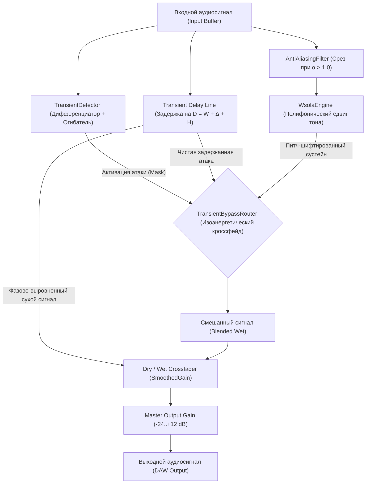
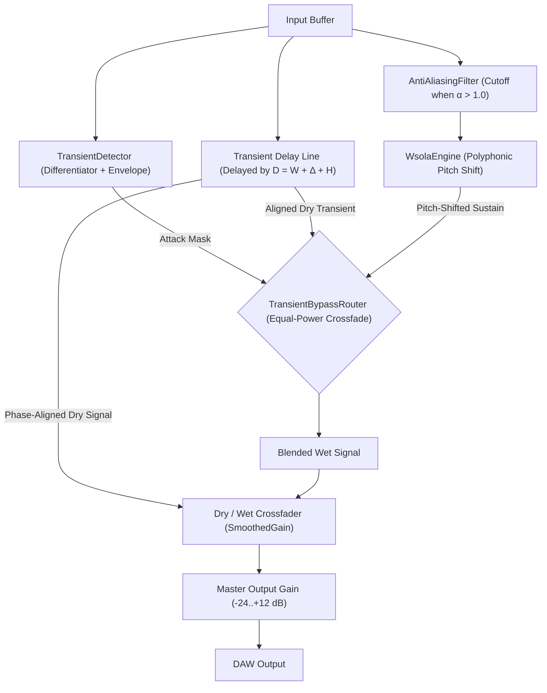

# PolyPitchShifter Architecture Specification
# Архитектурная спецификация PolyPitchShifter

---

## [RU] Архитектурная спецификация PolyPitchShifter

### 1. Ограничения безопасности потока аудио реального времени (Audio Thread)
Функция обратного вызова обработки звука в реальном времени (`processBlock`) выполняется под жесткими временными ограничениями хоста (например, 5.33 мс при частоте дискретизации 48 кГц и размере блока 256 сэмплов). Для полного предотвращения выпадений звука (xruns, click/pop artifacts) соблюдаются следующие фундаментальные правила:

- **Нулевые динамические выделения памяти в куче (Zero Heap Allocations):** Полный запрет на вызовы `malloc`, `free`, `new`, `delete`, а также любых операций с динамическим изменением размеров STL-контейнеров (`std::vector::push_back` и др.) внутри `processBlock`. Вся необходимая память предварительно аллоцируется на этапе инициализации в методе `prepareToPlay`.
- **Отсутствие блокирующих системных вызовов:** В звуковом потоке исключены мьютексы, системные блокировки, файловый ввод-вывод (File I/O) и логирование.
- **Потокобезопасная синхронизация параметров:** Обмен данными параметров между потоком графического интерфейса (UI Thread) и аудиопотоком (Audio Thread) выполняется на базе неблокирующих атомарных переменных `std::atomic`, управляемых через `juce::AudioProcessorValueTreeState` (APVTS).
- **Подавление денормализованных чисел (Denormal Prevention):** В начале каждого блока `processBlock` создается экземпляр `juce::ScopedNoDenormals` для отключения штрафов производительности процессора при вычислениях с околонулевыми числами с плавающей запятой на x86/x64.

### 2. Структура директорий и границы модулей
- `Source/DSP/`: Модули цифровой обработки сигналов:
  - `WsolaEngine`: Математическое ядро WSOLA (Waveform Similarity Based Overlap-Add) со стереофонической фазовой синхронизацией.
  - `TransientDetector`: Высокочастотный дифференцирующий детектор транзиентных атак медиатора.
  - `TransientBypassRouter`: Маршрутизатор задержки чистого сигнала с изоэнергетическим косинусным кроссфейдом.
  - `AntiAliasingFilter`: Каскадный 4-полюсный фильтр Баттерворта Direct Form II Transposed для подавления алиасинга при повышении тона.
  - `HermiteResampler`: 4-точечный кубический сплайн-ресэмплер 3-го порядка.
  - `AudioHistoryBuffer`: Кольцевой буфер предыстории с битовой маской степени двойки.
  - `CrossCorrelationFinder`: Поиск корреляции подобия с субсэмпловой параболической интерполяцией.
  - `Windowing`: Генерация и наложение оконных функций Хеннинга, Хэмминга, Блэкмана-Харриса.
  - `SmoothedGain`: Фильтр сглаживания параметров без артефактов (zipper noise).
- `Source/GUI/`: Пользовательский векторный интерфейс, кастомные поворотные регуляторы, LookAndFeel, осциллограф формы волны и измерители уровней.
- `Source/Utils/`: Высокопроизводительные неблокирующие структуры данных (`RingBuffer`, FIFO очереди).
- `Tests/`: Комплекс модульных, стресс- и бенчмарк-тестов.

### 3. Схема прохождения сигнала (Signal Flow)

### 4. Компенсация задержки плагина (PDC)
Плагин вносит постоянную алгоритмическую задержку $D_{\text{algo}}$, равную сумме окна анализа $W$, максимального поискового смещения $\Delta$ и шага синтеза $H$:
$$D_{\text{algo}} = W + \Delta + H$$
- При $F_s = 48\text{ кГц}$: $512 + 128 + 256 = 896\text{ сэмплов}$ ($18.67\text{ мс}$).
- При $F_s = 96\text{ кГц}$: $1024 + 256 + 512 = 1792\text{ сэмпла}$ ($18.67\text{ мс}$).
Задержка передается в DAW через `setLatencySamples()`, что позволяет хосту компенсировать временной сдвиг остальных дорожек проекта с точностью до сэмпла.

---

## [ENG] English Architecture Specification

### 1. Real-Time Audio Thread Safety Constraints
Real-time audio processing callbacks (`processBlock`) operate under strict time budgets (e.g. 5.33 ms at 48 kHz / 256 samples buffer). To prevent buffer dropouts (xruns) and audio glitches, the following rules are enforced:

- **Zero Heap Allocations:** No calls to `malloc`, `free`, `new`, `delete`, or operations resizing STL containers (`std::vector::push_back`, etc.) in `processBlock`. All buffers are pre-allocated in `prepareToPlay`.
- **No Blocking System Calls:** No mutexes, thread synchronization locks, file I/O, or logging on the audio thread.
- **Lock-Free Parameter Synchronization:** Parameter state updates between UI and DSP threads are handled via `std::atomic` values managed by `juce::AudioProcessorValueTreeState`.
- **Denormal Prevention:** `juce::ScopedNoDenormals` is instantiated at the entry of `processBlock` to disable subnormal floating-point processing overhead on x86/x64 CPUs.

### 2. Directory Structure and Module Boundaries
- `Source/DSP/`: Digital signal processing algorithms:
  - `WsolaEngine`: WSOLA overlap-add core with stereo phase alignment.
  - `TransientDetector`: Differentiating high-frequency pick attack detector.
  - `TransientBypassRouter`: Latency-aligned circular delay line and equal-power crossfader.
  - `AntiAliasingFilter`: Direct Form II Transposed 4th-order Butterworth filter.
  - `HermiteResampler`: 4-point 3rd-order cubic spline resampler.
  - `AudioHistoryBuffer`: Power-of-two lookback ring buffer.
  - `CrossCorrelationFinder`: Waveform similarity engine with parabolic sub-sample refinement.
  - `Windowing`: Hann, Hamming, and Blackman-Harris window generators.
  - `SmoothedGain`: Zipper-noise-free parameter smoothing filter.
- `Source/GUI/`: Custom vector UI components, rotary knobs, LookAndFeel, waveform visualizers, and level meters.
- `Source/Utils/`: High-performance lock-free data structures (`RingBuffer`, FIFO queues).
- `Tests/`: Unit tests, stress tests, and real-time benchmark suites.

### 3. End-to-End Signal Flow Architecture

### 4. Plug-in Delay Compensation (PDC)
The plugin introduces deterministic algorithmic latency $D_{\text{algo}}$ defined by:
$$D_{\text{algo}} = W + \Delta + H$$
- At $F_s = 48\text{ kHz}$: $512 + 128 + 256 = 896\text{ samples}$ ($18.67\text{ ms}$).
- At $F_s = 96\text{ kHz}$: $1024 + 256 + 512 = 1792\text{ samples}$ ($18.67\text{ ms}$).
Latency is reported to the host DAW via `setLatencySamples()`, ensuring sample-accurate project-wide track synchronization.
