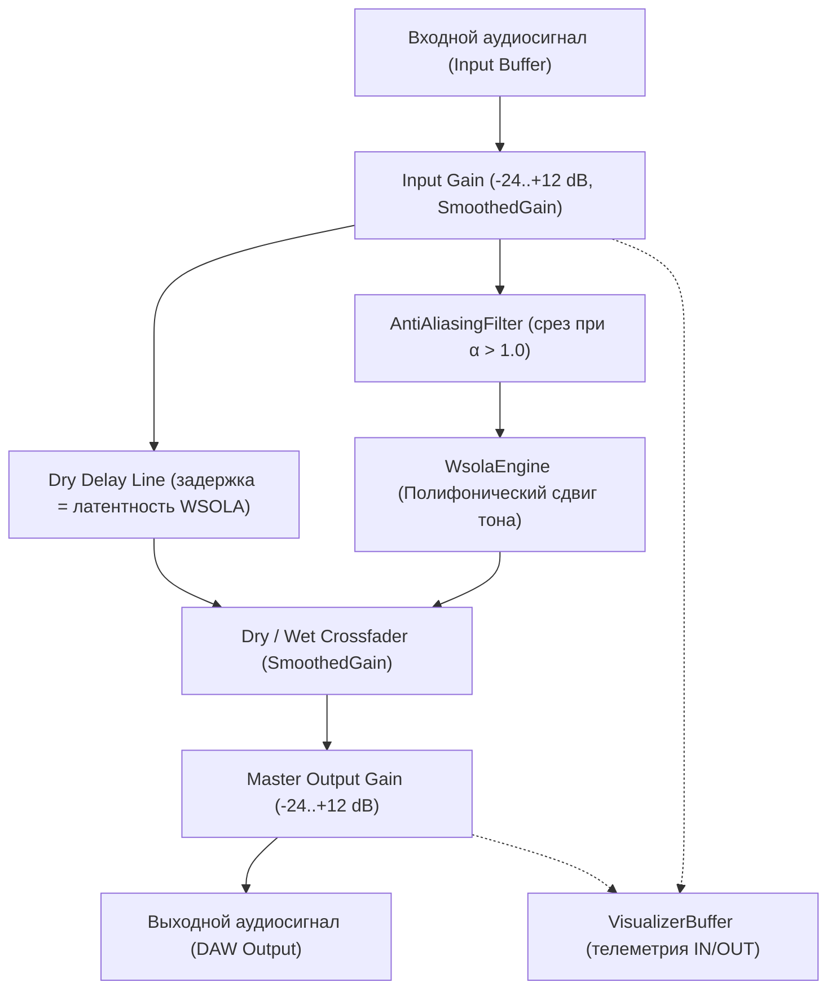
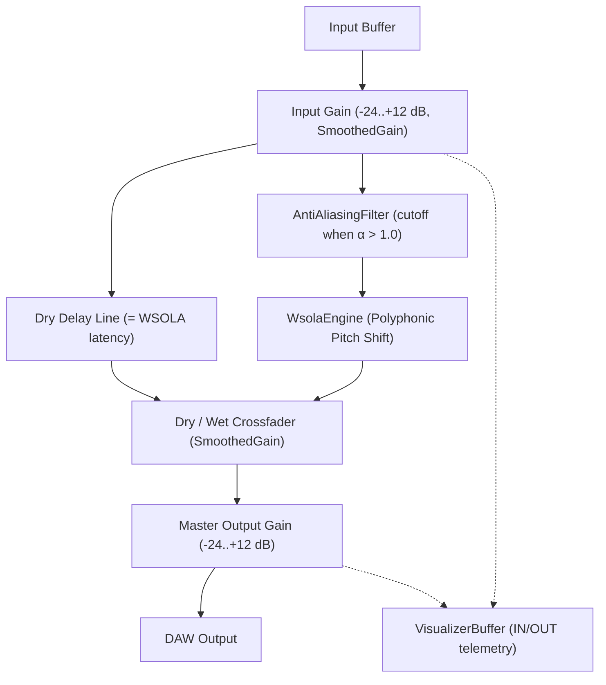

# PolyPitchShifter Architecture Specification
# Архитектурная спецификация PolyPitchShifter

---

## [RU] Архитектурная спецификация PolyPitchShifter

> [!IMPORTANT]
> **Актуальное состояние алгоритма.** Усиление/сохранение транзиентов через `Transient Bypass` и `Transient Sensitivity` **больше не выполняется**: оба параметра удалены из дерева параметров (APVTS), поскольку тесты показали нецелесообразность этого механизма (артефакты стыковки dry/wet-атаки, отсутствие слышимого выигрыша на фоне коротких окон WSOLA). Выход плагина — это напрямую питч-шифтированный сигнал WSOLA, смешанный с фазово-выровненным сухим сигналом. Классы `TransientDetector` и `TransientBypassRouter` сохранены в кодовой базе с собственными модульными тестами; в аудиотракте `TransientBypassRouter` работает только как линия задержки сухого сигнала на величину латентности WSOLA (`setEnabled(false)`), детектор в `processBlock` не вызывается.

### 1. Ограничения безопасности потока аудио реального времени (Audio Thread)
Функция обратного вызова обработки звука в реальном времени (`processBlock`) выполняется под жесткими временными ограничениями хоста (например, 5.33 мс при частоте дискретизации 48 кГц и размере блока 256 сэмплов). Для полного предотвращения выпадений звука (xruns, click/pop artifacts) соблюдаются следующие фундаментальные правила:

- **Нулевые динамические выделения памяти в куче (Zero Heap Allocations):** Полный запрет на вызовы `malloc`, `free`, `new`, `delete`, а также любых операций с динамическим изменением размеров STL-контейнеров (`std::vector::push_back` и др.) внутри `processBlock`. Вся необходимая память предварительно аллоцируется на этапе инициализации в методе `prepareToPlay`.
- **Отсутствие блокирующих системных вызовов:** В звуковом потоке исключены мьютексы, системные блокировки, файловый ввод-вывод (File I/O) и логирование. Работа с файлами пресетов выполняется только в потоке интерфейса (message thread).
- **Потокобезопасная синхронизация параметров:** Обмен данными параметров между потоком графического интерфейса (UI Thread) и аудиопотоком (Audio Thread) выполняется на базе неблокирующих атомарных переменных `std::atomic`, управляемых через `juce::AudioProcessorValueTreeState` (APVTS).
- **Подавление денормализованных чисел (Denormal Prevention):** В начале каждого блока `processBlock` создается экземпляр `juce::ScopedNoDenormals` для отключения штрафов производительности процессора при вычислениях с околонулевыми числами с плавающей запятой на x86/x64.

### 2. Параметры плагина (APVTS)
| ID | Название | Диапазон | По умолчанию |
| :--- | :--- | :--- | :--- |
| `bypass` | Bypass | вкл/выкл | выкл |
| `input_gain` | In Gain | -24 … +12 дБ | 0 дБ |
| `shift` | Shift | -12 … +12 полутонов | 0 |
| `fine` | Fine | -50 … +50 центов | 0 |
| `mix` | Mix | 0 … 100 % | 100 % |
| `gain` | Out Gain | -24 … +12 дБ | 0 дБ |

Параметры `Transient Bypass` и `Transient Sensitivity` (ранее — этап 3) удалены. Состояние плагина сериализуется только по перечисленным шести параметрам.

### 3. Структура директорий и границы модулей
- `Source/DSP/`: Модули цифровой обработки сигналов:
  - `WsolaEngine`: Математическое ядро WSOLA (Waveform Similarity Based Overlap-Add) со стереофонической фазовой синхронизацией; окно 1024 / шаг 512 / поиск ±512 сэмплов при 44.1/48 кГц (2048 / 1024 / ±1024 при ≥ 88.2 кГц).
  - `AntiAliasingFilter`: Каскадный 4-полюсный фильтр Баттерворта Direct Form II Transposed; встроен во входной тракт `WsolaEngine` и активируется при повышении тона ($\alpha > 1$).
  - `HermiteResampler`: 4-точечный кубический сплайн-ресэмплер 3-го порядка.
  - `AudioHistoryBuffer`: Кольцевой буфер предыстории с битовой маской степени двойки.
  - `CrossCorrelationFinder`: Поиск корреляции подобия с субсэмпловой параболической интерполяцией.
  - `Windowing`: Генерация и наложение оконных функций Хеннинга, Хэмминга, Блэкмана-Харриса.
  - `SmoothedGain`: Фильтр сглаживания параметров без артефактов (zipper noise).
  - `TransientBypassRouter`: линия задержки сухого сигнала на латентность WSOLA (режим обхода транзиентов отключён).
  - `TransientDetector`: детектор атак медиатора (сохранён, в аудиотракте не используется).
- `Source/PresetManager.*`: заводские пресеты (явные значения всех параметров) и хранение пользовательских пресетов в `Documents/PolyPitchShifter/Presets`; пресет с уже существующим именем (без учёта регистра) перезаписывает прежний.
- `Source/GUI/`: Пользовательский векторный интерфейс, кастомные поворотные регуляторы, LookAndFeel, осциллограф формы волны, спектроанализатор и измерители уровней.
- `Source/Utils/`: Высокопроизводительные неблокирующие структуры данных (`RingBuffer`, FIFO очереди).
- `Tests/`: Комплекс модульных, стресс- и бенчмарк-тестов (запуск: `Tests/run_all_tests.bat` или CTest).

### 4. Схема прохождения сигнала (Signal Flow)

### 5. Компенсация задержки плагина (PDC)
Плагин вносит постоянную алгоритмическую задержку $D_{\text{algo}}$, определяемую размером окна WSOLA:
- При $F_s = 44.1 / 48\text{ кГц}$: $1024\text{ сэмпла}$ ($\approx 21.3\text{ мс}$ при 48 кГц).
- При $F_s \ge 88.2\text{ кГц}$: $2048\text{ сэмплов}$ ($\approx 21.3\text{ мс}$ при 96 кГц).
Задержка передается в DAW через `setLatencySamples()` (значение показано в заголовке окна плагина как `PDC: N SPL`), что позволяет хосту компенсировать временной сдвиг остальных дорожек проекта с точностью до сэмпла. Сухой сигнал в Dry/Wet-кроссфейдере проходит через линию задержки на то же количество сэмплов, что исключает гребенчатую фильтрацию при `Mix` < 100 %.

### 6. Архитектура графического интерфейса и телеметрии реального времени (GUI Layer)
Пользовательский интерфейс построен на базе модульной дизайн-системы в темной студийной эстетике (Obsidian Dark Studio):
- **Связующий мост телеметрии (`VisualizerBuffer`)**: Неблокирующий циклический FIFO-буфер одиночного производителя и одиночного потребителя (SPSC) емкостью 4096 отсчетов. В звуковом потоке `processBlock` сбрасывает данные о форме волны, пиковых уровнях (Peak L/R), среднеквадратичных значениях (RMS L/R) и динамической частоте среза сглаживающего фильтра со сложностью $O(1)$ без аллокаций в куче и без захвата мьютексов.
- **Таймер обновления (60 FPS Timer)**: Поток интерфейса опрашивает `VisualizerBuffer` с частотой 60 Гц, обновляя осциллограф `WaveformVisualizer`, 1024-точечный спектроанализатор `SpectrumVisualizer` и стерео-индикатор `LevelMeter`.
- **Шкала `LevelMeter`**: от -60 до 0 дБ (метки 0, -6, -12, -18, -24, -36, -48, -60, крупный шрифт, метка «0» расположена сразу под красным делением 0 дБ) и зона +0…+6 дБ; красная индикация клиппа при превышении 0 dBFS.
- **Меню пресетов**: заводские пресеты (применяют конкретные значения Shift/Fine/Mix/Gain), пользовательские пресеты и выделенная акцентным цветом строка `SAVE CURRENT AS PRESET...`. Кнопки загрузки нет — пользовательский пресет загружается выбором его имени.
- **Векторный рендеринг (`CustomLookAndFeel`)**: Полностью процедурная векторная отрисовка круговых регуляторов с динамическими дугами свечения, переключателей-пилюль со светодиодными индикаторами и карточек `ControlPanel`.

---

## [ENG] English Architecture Specification

> [!IMPORTANT]
> **Current algorithm state.** Transient boosting / attack bypass via `Transient Bypass` and `Transient Sensitivity` **no longer happens**. Both parameters were removed from the APVTS because testing showed the mechanism to be impractical (dry/wet attack splice artifacts and no audible benefit with the short WSOLA windows). The plugin output is the WSOLA pitch-shifted signal mixed with the latency-aligned dry signal. `TransientDetector` and `TransientBypassRouter` remain in the code base with their own unit tests; in the audio path `TransientBypassRouter` acts only as a dry delay line matching the WSOLA latency (`setEnabled(false)`), and the detector is not called from `processBlock`.

### 1. Real-Time Audio Thread Safety Constraints
Real-time audio processing callbacks (`processBlock`) operate under strict time budgets (e.g. 5.33 ms at 48 kHz / 256 samples buffer). To prevent buffer dropouts (xruns) and audio glitches, the following rules are enforced:

- **Zero Heap Allocations:** No calls to `malloc`, `free`, `new`, `delete`, or operations resizing STL containers (`std::vector::push_back`, etc.) in `processBlock`. All buffers are pre-allocated in `prepareToPlay`.
- **No Blocking System Calls:** No mutexes, thread synchronization locks, file I/O, or logging on the audio thread. Preset file access happens on the message thread only.
- **Lock-Free Parameter Synchronization:** Parameter state updates between UI and DSP threads are handled via `std::atomic` values managed by `juce::AudioProcessorValueTreeState`.
- **Denormal Prevention:** `juce::ScopedNoDenormals` is instantiated at the entry of `processBlock` to disable subnormal floating-point processing overhead on x86/x64 CPUs.

### 2. Plugin Parameters (APVTS)
| ID | Name | Range | Default |
| :--- | :--- | :--- | :--- |
| `bypass` | Bypass | on/off | off |
| `input_gain` | In Gain | -24 … +12 dB | 0 dB |
| `shift` | Shift | -12 … +12 semitones | 0 |
| `fine` | Fine | -50 … +50 cents | 0 |
| `mix` | Mix | 0 … 100 % | 100 % |
| `gain` | Out Gain | -24 … +12 dB | 0 dB |

`Transient Bypass` and `Transient Sensitivity` (introduced in stage 3) have been removed. Plugin state serializes only the six parameters above.

### 3. Directory Structure and Module Boundaries
- `Source/DSP/`: Digital signal processing algorithms:
  - `WsolaEngine`: WSOLA overlap-add core with stereo phase alignment; window 1024 / hop 512 / search ±512 samples at 44.1/48 kHz (2048 / 1024 / ±1024 at ≥ 88.2 kHz).
  - `AntiAliasingFilter`: Direct Form II Transposed 4th-order Butterworth filter; embedded in the `WsolaEngine` input path and engaged when pitching up ($\alpha > 1$).
  - `HermiteResampler`: 4-point 3rd-order cubic spline resampler.
  - `AudioHistoryBuffer`: Power-of-two lookback ring buffer.
  - `CrossCorrelationFinder`: Waveform similarity engine with parabolic sub-sample refinement.
  - `Windowing`: Hann, Hamming, and Blackman-Harris window generators.
  - `SmoothedGain`: Zipper-noise-free parameter smoothing filter.
  - `TransientBypassRouter`: dry delay line matching WSOLA latency (attack bypass mode disabled).
  - `TransientDetector`: pick attack detector (kept, not used in the audio path).
- `Source/PresetManager.*`: factory presets (explicit values for every parameter) and user preset storage in `Documents/PolyPitchShifter/Presets`; saving under an existing name (case-insensitive) overwrites the old preset.
- `Source/GUI/`: Custom vector UI components, rotary knobs, LookAndFeel, waveform and spectrum visualizers, and level meters.
- `Source/Utils/`: High-performance lock-free data structures (`RingBuffer`, FIFO queues).
- `Tests/`: Unit tests, stress tests, and real-time benchmark suites (run `Tests/run_all_tests.bat` or CTest).

### 4. End-to-End Signal Flow Architecture

### 5. Plug-in Delay Compensation (PDC)
The plugin introduces deterministic algorithmic latency $D_{\text{algo}}$ set by the WSOLA window size:
- At $F_s = 44.1 / 48\text{ kHz}$: $1024\text{ samples}$ ($\approx 21.3\text{ ms}$ at 48 kHz).
- At $F_s \ge 88.2\text{ kHz}$: $2048\text{ samples}$ ($\approx 21.3\text{ ms}$ at 96 kHz).
Latency is reported to the host DAW via `setLatencySamples()` (shown in the plugin header as `PDC: N SPL`), ensuring sample-accurate project-wide track synchronization. The dry path of the Dry/Wet crossfader is delayed by the same number of samples, preventing comb filtering when `Mix` < 100 %.

### 6. GUI Subsystem & Real-Time Telemetry Layer
The graphical user interface implements a responsive, high-contrast dark studio design system:
- **Lock-Free Telemetry Bridge (`VisualizerBuffer`)**: Single-Producer Single-Consumer (SPSC) circular FIFO with capacity 4096 samples. `processBlock` streams audio waveforms, peak amplitudes, RMS levels, and Butterworth filter cutoff frequencies in $O(1)$ time with zero heap allocations and zero mutex locks.
- **60 FPS GUI Refresh Loop**: The message thread consumes telemetry and renders real-time audio dynamics through `WaveformVisualizer` (dry/wet oscilloscope), `SpectrumVisualizer` (1024-FFT logarithmic spectrum with dynamic anti-aliasing cutoff indicator), and `LevelMeter` (stereo peak/RMS bar meter with clip hold).
- **`LevelMeter` scale**: -60 to 0 dB (labels 0, -6, -12, -18, -24, -36, -48, -60 in a larger font, the "0" label placed right under the red 0 dB tick) plus a +0…+6 dB headroom zone; red clip indication above 0 dBFS.
- **Preset menu**: factory presets (apply concrete Shift/Fine/Mix/Gain values), user presets, and an accent-coloured `SAVE CURRENT AS PRESET...` row. There is no load button — a user preset is loaded by selecting its name.
- **Custom Vector Graphics (`CustomLookAndFeel`)**: Procedurally rendered vector knobs with illuminated glow arcs, hardware-style pill switches, and glassmorphic card containers (`ControlPanel`).

