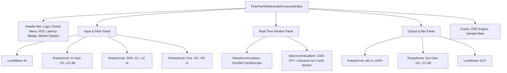
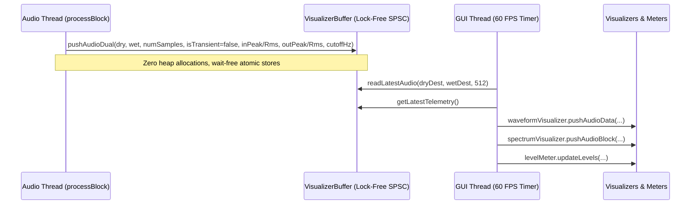

# PolyPitchShifter - UI/UX Design System & Real-Time Visualizers
# Пользовательский интерфейс и система визуализации реального времени

[RU] Данный документ описывает архитектуру пользовательского интерфейса (UI/UX), дизайн-систему, векторные графические компоненты и механизмы потокобезопасного обмена телеметрией между потоком обработки аудиосигнала (Audio Thread) и графическим потоком (Message Thread) VST3-плагина **PolyPitchShifter**.

[ENG] This document specifies the UI/UX architecture, design system tokens, vector audio controls, and the thread-safe telemetry bridge between the real-time audio thread and GUI message thread for the **PolyPitchShifter** VST3 audio plugin.

---

## 1. Design Aesthetics & Visual Tokens / Дизайн-система и палитра

### [RU] Цветовая палитра Obsidian Dark Studio
Пользовательский интерфейс выполнен в темной эстетике студийного рэкового оборудования высокого класса. В палитре используются глубокие обсидиановые оттенки фона с акцентным цветовым кодированием функциональных блоков:
- **Фон и каркас (`GuiTokens`)**:
  - `bgDeep` (`#0E1015`): Глубокий обсидиановый базовый цвет окна плагина.
  - `bgHeader` (`#12141B`): Верхняя шапка и нижний информационный бар.
  - `panelBg` (`#151821`): Поверхности модульных карт (`ControlPanel`).
  - `innerDockBg` (`#101218`): Фон визира осциллографа и спектрального анализатора.
  - `outlineBorder` (`#282D3D`): Тонкая 1px граница компонентов.
- **Семантические акценты**:
  - `accentCyan` (`#00E5FF`): Электрический циан — алгоритм WSOLA, питч-шифтинг, осциллограмма.
  - `accentAmber` (`#FF9100`): Солнечный янтарь — секция Output & Mix и индикатор OUT.
  - `accentGreen` (`#00E676`): Изумрудный актив — уровни выходного сигнала, регуляторы Mix и Gain.
  - `accentRed` (`#FF1744`): Индикация клиппирования (> 0 dBFS) и мастер-байпас.

### [ENG] Obsidian Dark Studio Palette
The UI is styled after high-end hardware rackmount digital audio gear:
- **Surface Palettes**:
  - `bgDeep` (`#0E1015`): Deep obsidian window background.
  - `bgHeader` (`#12141B`): Header and footer bars.
  - `panelBg` (`#151821`): Modular card surfaces (`ControlPanel`).
  - `innerDockBg` (`#101218`): Visualizer bay canvas.
  - `outlineBorder` (`#282D3D`): 1px borders.
- **Functional Accents**:
  - `accentCyan` (`#00E5FF`): Pitch engine and shifted waveform.
  - `accentAmber` (`#FF9100`): Output & Mix section and the OUT meter header.
  - `accentGreen` (`#00E676`): Signal output levels and Dry/Wet mix.
  - `accentRed` (`#FF1744`): Peak clip warning and Master Bypass.

---

## 2. Component Hierarchy / Иерархия компонентов

> **Note / Примечание:** The former *Sensitivity* knob and *Attack Clarity* toggle no longer exist — transient boosting via `Transient Bypass` / `Transient Sensitivity` was removed because testing showed it to be impractical. / Регулятор *Sensitivity* и переключатель *Attack Clarity* удалены: усиление транзиентов через `Transient Bypass` / `Transient Sensitivity` более не выполняется, так как тесты показали его нецелесообразность.

### [RU] Описание компонентов
1. **`CustomLookAndFeel`**: Централизованный векторный рендерер интерфейса JUCE. Отрисовывает дуговые энкодеры с динамическим свечением, поворотные указатели, сглаженные ползунки и кастомные переключатели.
2. **`RotaryKnob`**: Специализированный компонент регулятора. Включает верхний заголовок, круговой слайдер с двойным кликом возврата к дефолту и нижний текстовый индикатор с форматированием единиц (`st`, `ct`, `%`, `dB`, `x`).
3. **`PillToggle`**: Кнопка-переключатель в форме аппаратной пилюли со встроенным светодиодным индикатором и мягким свечением активного состояния. Используется для главного обхода (Bypass).
4. **`ControlPanel`**: Стеклянная модульная карточка с акцентным маркером в заголовке и отсеченной рабочей областью `getContentBounds()`.
5. **`LevelMeter`**: Двухканальный стерео-измеритель уровня с мгновенной атакой, экспоненциальной баллистикой спада, пиковыми метками (Peak Hold) и индикацией перегрузки (> 0 dBFS). Шкала -60…0 дБ с крупными подписями (0, -6, -12, -18, -24, -36, -48, -60); подпись «0» расположена сразу под красным делением 0 дБ, красная подсветка клиппа при > 0 dBFS не изменена.
6. **`WaveformVisualizer`**: Осциллограф реального времени. Отображает исходную волну (сухой сигнал, выровненный по задержке) и результирующую волну (питч-шифтер). Стробоскопический импульс атаки медиатора больше не активируется — детекция транзиентов не используется в аудиотракте.
7. **`SpectrumVisualizer`**: Быстрый 1024-точечный спектроанализатор с логарифмической шкалой (20 Гц – 20 кГц) и динамической пунктирной линией среза сглаживающего фильтра Баттерворта (Anti-Aliasing Filter Cutoff).
8. **Меню пресетов (`juce::ComboBox`)**: заводские пресеты (Standart D…A, Octave Down/Up, Octaver Low/High, Virtual Capo +1/+2) применяют конкретные значения Shift/Fine/Mix/Gain; пользовательские пресеты хранятся в `Documents/PolyPitchShifter/Presets`, сохранение под существующим именем перезаписывает пресет; строка `+ SAVE CURRENT AS PRESET...` отделена разделителем и выделена акцентным цветом. Кнопки загрузки нет — пресет загружается выбором имени.

---

## 3. Real-Time Thread Safety / Потокобезопасность реального времени

### [RU] Архитектура телеметрии без блокировок
- **Принцип реального времени**: Графический интерфейс никогда не обращается напрямую к структурам данных DSP-ядра и не захватывает мьютексы, которые могли бы заблокировать поток аудио (Audio Thread).
- **Кольцевой буфер `VisualizerBuffer`**:
  - Реализован как кольцевой буфер емкостью 4096 отсчетов с битовой маской `Mask = 4095`.
  - Указатели чтения и записи управляются с помощью `std::atomic<size_t>` с семантикой `acquire/release`.
  - Поля телеметрии (пики, RMS входа/выхода, частота среза фильтра; флаг транзиентов зарезервирован и всегда `false`) изолированы с выравниванием `alignas(64)` для предотвращения эффекта ложного разделения строк кэша (false sharing).
  - В потоке `processBlock` гарантировано отсутствие любых системных вызовов `malloc`/`free`.

### [ENG] Lock-Free Telemetry Architecture
- **Real-Time Guarantee**: The GUI thread never blocks the audio rendering thread or acquires audio mutexes.
- **Circular FIFO `VisualizerBuffer`**:
  - Lock-free, wait-free Single-Producer Single-Consumer (SPSC) design with capacity 4096 and bitwise masking.
  - Atomic read/write positions with acquire/release semantics.
  - Telemetry variables padded to 64 bytes (`alignas(64)`) to eliminate CPU cacheline false sharing.
  - Zero heap allocations during `processBlock` execution.

---

## 4. Responsive Layout & Scalability / Адаптивная верстка

### [RU] Параметры окна
- **Базовый размер**: 840 × 520 px (оптимально для Full HD и 4K дисплеев при масштабировании хоста 100%–200%).
- **Минимальный размер**: 720 × 460 px (сохранение читаемости всех подписей и шкал).
- **Максимальный размер**: 1400 × 900 px (просторная детальная визуализация спектра и осциллограммы).
- Все векторные элементы (`juce::Path`, градиенты, шрифты) рендерятся процедурно без потери четкости при любом DPI.

### [ENG] Window Metrics
- **Default Resolution**: 840 × 520 px.
- **Minimum Resolution**: 720 × 460 px.
- **Maximum Resolution**: 1400 × 900 px.
- Pure vector rendering via `juce::Path` and procedural gradients ensures razor-sharp fidelity on high-DPI and Retina displays.
