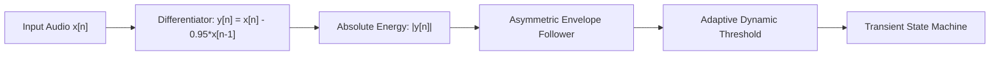

# Transient Processing and Pick Attack Preservation Specification
# Спецификация обработки транзиентов и сохранения атак медиатора

---

## [RU] Русскоязычная спецификация модуля транзиентной обработки

> [!IMPORTANT]
> **Примечание**: Параметры `Transient Bypass` и `Transient Sensitivity` больше не являются настраиваемыми пользователем и удалены из интерфейса автоматизации, так как тесты показали их нецелесообразность. Логика обхода транзиентов отключена (`transientRouter.setEnabled(false)`).

### 1. Высокочастотный дифференцирующий предкорректирующий фильтр (Pre-Emphasis)
В полифоническом сигнале электрогитары атака медиатора по струнам характеризуется экстремально малым временем нарастания ($\le 1.0$ мс) и высокой концентрацией спектральной энергии в области верхних частот по сравнению со стационарным квазипериодическим гармоническим сустейном колебаний струн. Для надежной селекции атак от низкочастотных основных тонов применяется дискретный дифференцирующий фильтр высоких частот:

$$y[n] = x[n] - 0.95 \cdot x[n-1]$$

#### Частотные характеристики
Передаточная функция фильтра в $z$-плоскости:

$$H(z) = 1 - 0.95 \cdot z^{-1}$$

- На нулевой частоте $\omega = 0$ (постоянная составляющая, низкочастотный резонанс деки): $|H(e^{j0})| = 1 - 0.95 = 0.05$ (ослабление $-26\text{ дБ}$).
- На частоте Найквиста $\omega = \pi$: $|H(e^{j\pi})| = 1 - (-0.95) = 1.95$ (усиление $+5.8\text{ дБ}$).
- Высокочастотные компоненты щелчка медиатора усиливаются более чем на $31\text{ дБ}$ относительно низких гармоник.

### 2. Асимметричный детектор огибающей и адаптивное пороговое значение
Для мгновенного обнаружения фронта атаки с плавным отслеживанием затухания энергии используется рекурсивный асимметричный огибатель:

$$E[n] = \begin{cases} (1 - \alpha_{\text{att}}) \cdot E[n-1] + \alpha_{\text{att}} \cdot |y[n]|, & \text{если } |y[n]| > E[n-1] \\ (1 - \alpha_{\text{rel}}) \cdot E[n-1] + \alpha_{\text{rel}} \cdot |y[n]|, & \text{если } |y[n]| \le E[n-1] \end{cases}$$

#### Постоянные времени:
- **Время атаки:** $\tau_{\text{att}} = 0.5\text{ мс} \implies \alpha_{\text{att}} \approx 0.80$ при $F_s = 48\text{ кГц}$.
- **Время спада:** $\tau_{\text{rel}} = 15.0\text{ мс} \implies \alpha_{\text{rel}} \approx 0.005$ при $F_s = 48\text{ кГц}$.

#### Адаптивный динамический порог:
Для исключения ложных срабатываний при громком гитарном бое (аккордовом чесе) с сохранением высокой чувствительности в тихих пассажах, порог срабатывания адаптируется к текущему фоновому уровню:

$$B[n] = (1 - \alpha_{\text{bg}}) \cdot B[n-1] + \alpha_{\text{bg}} \cdot E[n]$$

$$\text{Threshold}[n] = \max\left(B[n] \cdot (1.8 \cdot \text{Sensitivity}), 0.002\right)$$

При превышении $E[n] > \text{Threshold}[n]$ детектор инициирует транзиентное событие синхронно для всех каналов стереопары, гарантируя сохранность стереопанорамы и фазовой когерентности.

### 3. Фильтр защиты от спектрального наложения (Антиэлайзинг)
При сдвиге высоты тона вверх на коэффициент $\alpha > 1.0$ (например, на октаву $\alpha = 2.0$) все спектральные составляющие умножаются на $\alpha$. Компоненты, для которых $f \cdot \alpha > F_s / 2$, зеркально отражаются от границы Найквиста назад в слышимый диапазон частот в виде негармонического диссонирующего алиасинга.
Для полного устранения данного явления применяется каскадный 4-полюсный (4-й порядок, крутизна среза 24 дБ/октава) фильтр Баттерворта в прямой транспонированной форме II (Direct Form II Transposed).

Динамическая частота среза рассчитывается по формуле:
$$\omega_c = \frac{F_s / 2}{\alpha} \cdot 0.92$$
где множитель $0.92$ формирует безопасный переходный диапазон для подавления частот выше Найквиста более чем на 40 дБ.

Добротности двух каскадных звеньев 2-го порядка (биквадратов):
$$Q_1 = \frac{1}{2 \cos(3\pi / 8)} \approx 0.5411961$$
$$Q_2 = \frac{1}{2 \cos(\pi / 8)} \approx 1.3065630$$

Билинейное $z$-преобразование с частотной деформацией (Frequency Warping):
$$K = \tan\left(\frac{\pi f_c}{F_s}\right)$$

### 4. Маршрутизатор байпаса атак и изоэнергетический кроссфейд
При обнаружении транзиента атаки необработанный чистый сигнал задерживается в циклическом буфере ровно на величину алгоритмической задержки WSOLA $D = W + \Delta + H$ для сэмпловой синхронизации.
Для предотвращения провалов мощности и щелчков при переключении между чистой атакой и питч-шифтированным сустейном применяется изоэнергетический косинусный кроссфейд:

$$g_{\text{transient}} = \sin\left(\text{mask} \cdot \frac{\pi}{2}\right)$$
$$g_{\text{wet}} = \cos\left(\text{mask} \cdot \frac{\pi}{2}\right)$$
$$g_{\text{transient}}^2 + g_{\text{wet}}^2 = \sin^2\left(\frac{\pi}{2}\text{mask}\right) + \cos^2\left(\frac{\pi}{2}\text{mask}\right) \equiv 1.0$$

Суммарная акустическая мощность сохраняется строго инвариантной при любых переходных процессах.

---

## [ENG] English Transient Processing Specification

### 1. High-Frequency Differentiating Pre-Emphasis Filter
In polyphonic electric guitar audio, string pick strikes exhibit extremely rapid transient risetimes ($\le 1.0$ ms) and concentrated high-frequency spectral content compared to the continuous harmonic sustain of resonating strings. To isolate pick strikes from low-frequency fundamental oscillations, an aggressive discrete-time differentiating pre-emphasis filter is applied:

$$y[n] = x[n] - 0.95 \cdot x[n-1]$$

#### Frequency Response Characteristics
The transfer function of the filter in the $z$-domain is:

$$H(z) = 1 - 0.95 \cdot z^{-1}$$

- At $\omega = 0$ (DC, fundamental guitar body resonance): $|H(e^{j0})| = 1 - 0.95 = 0.05$ ($-26\text{ dB}$ attenuation).
- At $\omega = \pi$ (Nyquist boundary): $|H(e^{j\pi})| = 1 - (-0.95) = 1.95$ ($+5.8\text{ dB}$ boost).
- High frequencies containing the crisp pick click and scratch are boosted by more than $31\text{ dB}$ relative to DC.

### 2. Asymmetric Envelope Follower & Dynamic Thresholding
To capture the instantaneous onset while smoothly tracking energy decay, an asymmetric recursive envelope follower is employed:

$$E[n] = \begin{cases} (1 - \alpha_{\text{att}}) \cdot E[n-1] + \alpha_{\text{att}} \cdot |y[n]|, & \text{if } |y[n]| > E[n-1] \\ (1 - \alpha_{\text{rel}}) \cdot E[n-1] + \alpha_{\text{rel}} \cdot |y[n]|, & \text{if } |y[n]| \le E[n-1] \end{cases}$$

#### Time Constants
- **Attack time constant:** $\tau_{\text{att}} = 0.5\text{ ms} \implies \alpha_{\text{att}} \approx 0.80$ at $F_s = 48\text{ kHz}$.
- **Release time constant:** $\tau_{\text{rel}} = 15.0\text{ ms} \implies \alpha_{\text{rel}} \approx 0.005$ at $F_s = 48\text{ kHz}$.

#### Adaptive Dynamic Background Threshold
To avoid false triggers during loud continuous guitar strumming while maintaining sensitivity during quiet single-note passages, the trigger threshold adapts dynamically to the running background energy:

$$B[n] = (1 - \alpha_{\text{bg}}) \cdot B[n-1] + \alpha_{\text{bg}} \cdot E[n]$$

$$\text{Threshold}[n] = \max\left(B[n] \cdot (1.8 \cdot \text{Sensitivity}), 0.002\right)$$

When $E[n] > \text{Threshold}[n]$, an attack transient is triggered across stereo channels simultaneously to maintain perfect phase coherence.

### 3. Anti-Aliasing Filter Synthesis and Dynamic Nyquist Tracking
When shifting pitch up by a ratio $\alpha > 1.0$ (e.g. $+12$ semitones, $\alpha = 2.0$), high frequency spectral components are expanded by factor $\alpha$. Any frequency originally satisfying $f \cdot \alpha > F_s / 2$ would alias back down into the audible spectrum.
To prevent aliasing distortion, a 4th-order (24 dB/octave) Butterworth lowpass filter in Direct Form II Transposed is cascaded:

$$\omega_c = \frac{F_s / 2}{\alpha} \cdot 0.92$$

where the $0.92$ factor creates a guard band ensuring $> 40\text{ dB}$ stopband rejection above Nyquist.

Butterworth Q factors:
$$Q_1 = \frac{1}{2 \cos(3\pi / 8)} \approx 0.5411961$$
$$Q_2 = \frac{1}{2 \cos(\pi / 8)} \approx 1.3065630$$

Bilinear transform with pre-warping:
$$K = \tan\left(\frac{\pi f_c}{F_s}\right)$$

### 4. Transient Bypass Router and Equal-Power Cosine Crossfade
Upon transient detection, clean unshifted audio is delayed in a circular buffer by exactly the WSOLA algorithmic latency $D = W + \Delta + H$ to ensure sample-accurate alignment.
An equal-power cosine crossfade prevents energy dips and switching clicks:

$$g_{\text{transient}} = \sin\left(\text{mask} \cdot \frac{\pi}{2}\right)$$
$$g_{\text{wet}} = \cos\left(\text{mask} \cdot \frac{\pi}{2}\right)$$
$$g_{\text{transient}}^2 + g_{\text{wet}}^2 = \sin^2\left(\frac{\pi}{2}\text{mask}\right) + \cos^2\left(\frac{\pi}{2}\text{mask}\right) \equiv 1.0$$

Acoustic energy is conserved throughout the entire transition.
